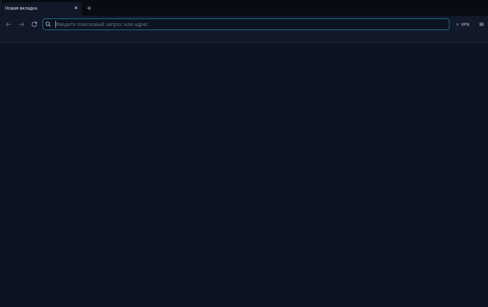
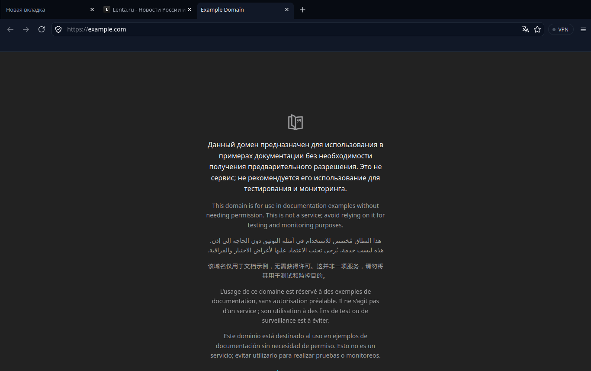
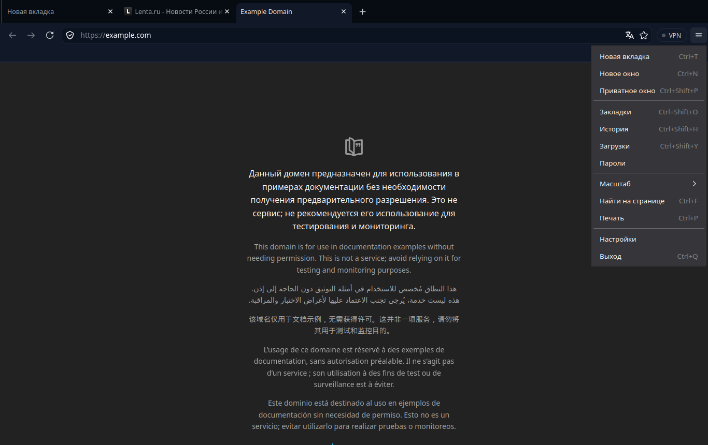
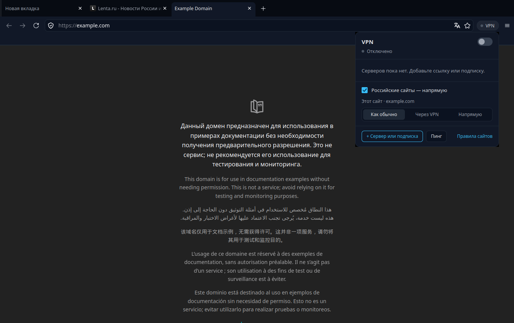
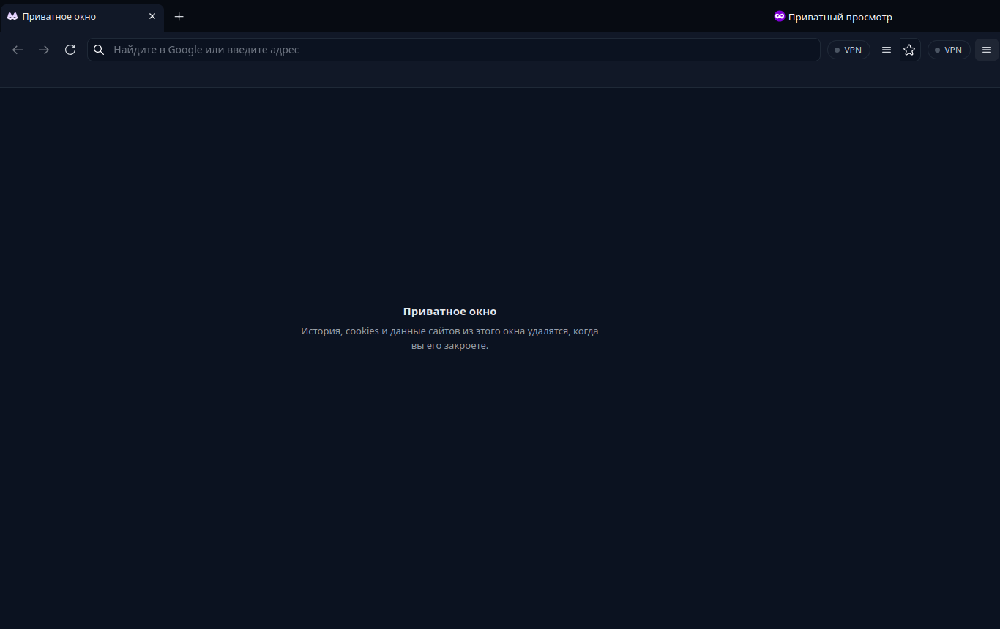
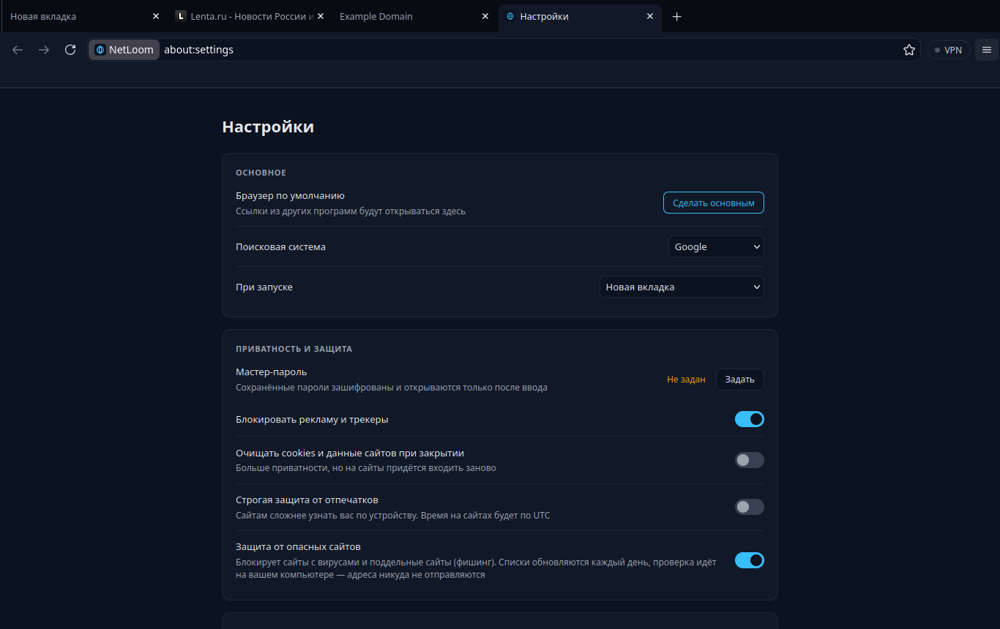
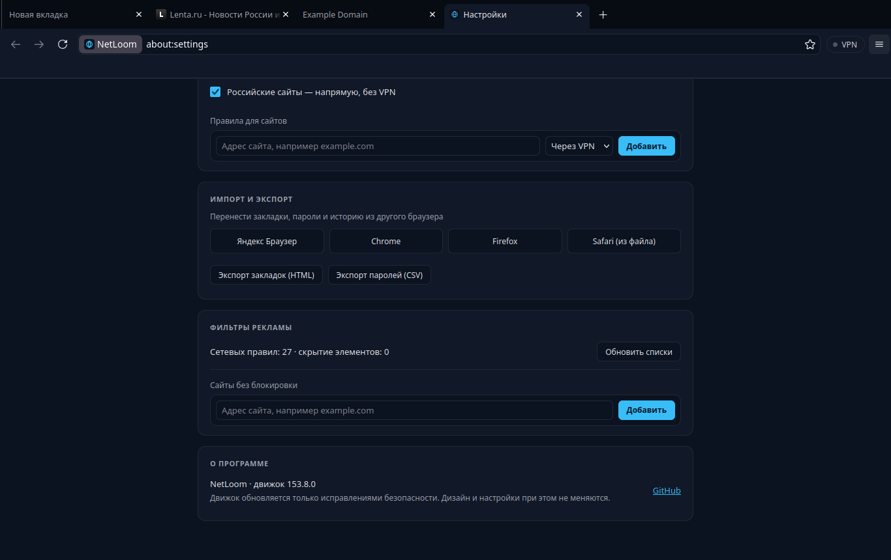
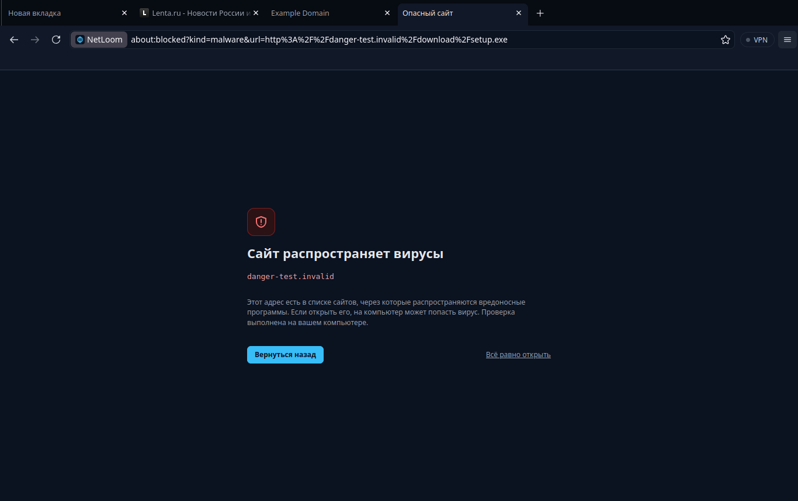
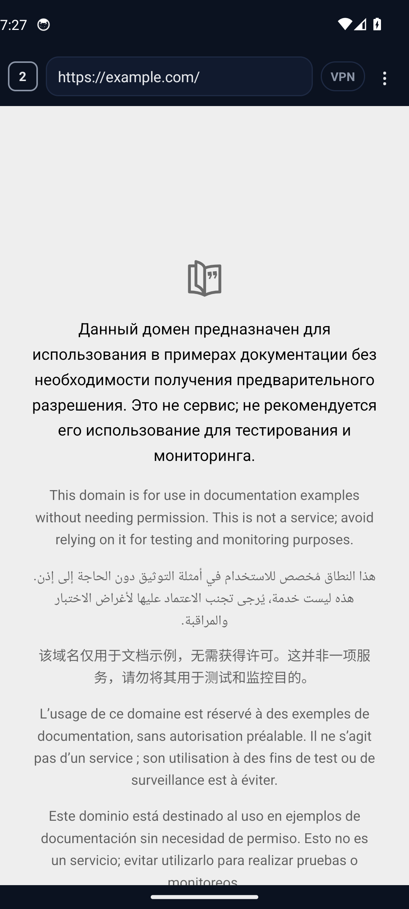
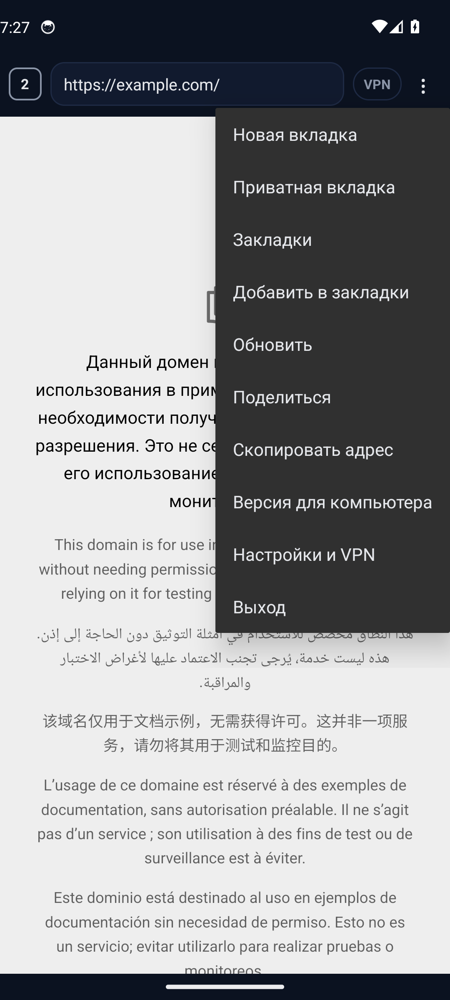

# Проверка NetLoom

Коммит 8377cc4, 2026-11-25 19:28 UTC.

## Скорость (8 сайтов, Linux, одинаковые условия)

| Вариант | Запуск и загрузка 8 сайтов, сек процессора | Простой 30 с, % процессора | Память (PSS), МБ | Процессов |
|---|---|---|---|---|
| движок-без-NetLoom | 53.9 | 16 | 1740 | 26 |
| NetLoom | 33.2 | 9 | 1552 | 17 |

## Компьютер

## Android

